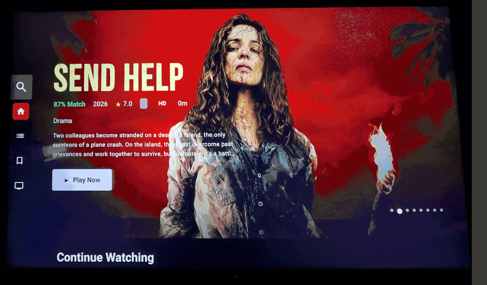

# 🎬 HomeFlix TV — Android TV Streaming Client

**Version 5.13.2** — A Netflix/Prime‑grade Android TV client for the HomeFlix media server. Full‑bleed cinematic UI with auto‑playing background previews, a red‑and‑black HomeFlix theme, D‑pad‑first navigation, and an ExoPlayer video pipeline that buffers ahead for smooth playback. Built with Jetpack Compose and deliberately tuned to stay light on low‑RAM TVs (e.g. a 2 GB Sony Android TV).

    

---
## 📱 App Preview



## 1. Overview

HomeFlix TV is the living‑room client of the HomeFlix ecosystem (Go media server + Next.js web app + this TV app). It talks to the same REST API as the web app and focuses on:

- **Cinematic browsing** — full‑bleed heroes with muted auto‑playing preview clips, Top‑10 rows, "art + logo" landscape cards, and poster grids.
- **Continue Watching** across movies and TV series, with real resume.
- **Smooth playback** — direct play of the server's files, buffer‑ahead ExoPlayer config, subtitle/audio selection.
- **Low‑RAM friendliness** — the app detects constrained devices and scales caches, image bitmap depth, and playback buffers accordingly.

## 2. Tech stack

| Concern | Choice |
|---|---|
| UI | Jetpack Compose (Material 3) |
| DI | Hilt |
| Navigation | Navigation‑Compose (global fade transitions) |
| Media | AndroidX **Media3 / ExoPlayer** |
| Images | **Coil** (custom `ImageLoader`) |
| Networking | Retrofit + OkHttp + Gson |
| Async | Coroutines + StateFlow |
| SDK | `compileSdk/targetSdk 36`, `minSdk 23` |

## 3. Architecture

Clean‑ish MVVM with a single Hilt‑provided repository.

```
com.homeflix.tv/
├── HomeFlixTVApplication.kt        # Hilt app; Coil loader; server probe at boot
├── di/                             # NetworkModule (Retrofit + failover), RepositoryModule
├── domain/
│   ├── model/                      # Media, Genre, Notification, Playback, StreamInfo …
│   └── repository/MediaRepository  # interface
├── data/
│   ├── remote/api/HomeFlixApiService   # Retrofit endpoints
│   ├── remote/dto/                     # DTOs + toDomain() mappers
│   └── repository/MediaRepository      # implementation
├── presentation/
│   ├── MainActivity.kt             # single activity; theme + NavHost
│   ├── navigation/HomeFlixNavigation   # NavHost + Screen routes (fade transitions)
│   ├── screens/                    # one folder per screen (Screen + ViewModel)
│   │   ├── home/ NetflixHomeScreen + HomeViewModel
│   │   ├── details/ (movie) · tvshows/ (series list, series details, season, player-agnostic)
│   │   ├── browse/ · search/ · mylist/ · notifications/
│   │   └── player/ VideoPlayerScreen + VideoPlayerViewModel
│   ├── components/                 # shared, reusable composables (see §5)
│   └── theme/                      # Color.kt (red/black), Type, Theme
└── util/                           # ApiUtils, ImageCache, DeviceCapabilities,
                                    #   ServerConfig, NetworkMonitor, RetryPolicy
```

**Data flow:** `Screen` → `hiltViewModel()` → `MediaRepository` → `HomeFlixApiService` (Retrofit). ViewModels expose `StateFlow<UiState>`; screens `collectAsState()` and render. DTOs map to domain models via `toDomain()`.

## 4. Design system (RED + BLACK)

All colors live in `presentation/theme/Color.kt`. The palette is HomeFlix **black canvas + Netflix‑red accent**. For historical reasons the tokens are named `Prime*`, but their **values** are black/red — change them in one place to re‑skin the whole app:

| Token | Value | Use |
|---|---|---|
| `PrimeBg` | `#0B0B0B` | page background |
| `PrimeBgDeep` | `#000000` | hero gradient target |
| `PrimeSurface` / `PrimeSurfaceHigh` | `#1A1A1A` / `#2A2A2A` | cards, focused surface |
| `PrimeBlue` | `#E50914` | **accent = Netflix red** (focus, CTAs, progress) |
| `PrimeTextDim` | `#B3B3B3` | secondary text |
| `RatingGold` | `#FFB43A` | ★ ratings |
| `NetflixRed` | `#E50914` | brand wordmark |

Focus is shown with a **2 dp white border + `graphicsLayer` scale** (draw‑time, no relayout).

## 5. Key components (`presentation/components/`)

| Component | Role |
|---|---|
| `CinematicHero` | Home hero: full‑bleed backdrop → auto preview video, logo/metadata, Play/More Info |
| `BackgroundVideo` | Lifecycle‑safe muted looping preview player (kept small‑buffer) |
| `FeaturedBanner` | "half/half" section: one big banner + rotating side picks |
| `Top10Row` | Prime‑style big outlined rank numbers |
| `PosterCard` | Shared 2:3 poster card (Search, My List, rows) |
| `ThumbLogoCard` / `ThumbLogoRow` | 16:9 backdrop **with title logo composited** — the "art + logo" style used on Movies/Browse, More‑like‑this, Trending |
| `ContinueWatchingRow` | Movie continue‑watching (episode‑aware) |
| `ContinueWatchingSeriesRow` | **TV** continue‑watching: one card per series (series banner), resumes the in‑progress episode |
| `MediaRow` / `MediaCard` | Generic poster row/card |
| `NetflixSideNavigation` | 48 dp left rail (Search, Home, Browse, TV Shows, My List, Notifications) |
| `SidebarOverlay` | Slides the rail in over full‑bleed detail pages on LEFT press |
| `VideoPlayer` | The player UI + ExoPlayer wiring (see §7) |
| `PlayerSettingsPanel` | D‑pad settings drawer (speed / subtitles / audio) |

## 6. Screens & flow

- **Home** — Cinematic hero → Continue Watching → Featured banner (big + rotating) → Top 10 → a thumb+logo Trending row → a genre row. UP from the first row returns focus to the hero and scrolls to top.
- **Movies (Browse)** — genre‑grouped **thumb+logo** rows ("Recently Added" + Action/Drama/Comedy/Sci‑Fi/… + "All Movies"), built client‑side from one capped batch.
- **Search** — on‑screen QWERTY keyboard + **large poster grids** (results and Top Searches).
- **My List** — Continue Watching rail + poster grid + empty state.
- **TV Shows** — series **CinematicHero** (red "Episodes" Play button) → **Continue Watching (series banners)** → Popular + genre‑grouped series rows.
- **Movie Details** — full‑bleed hero (backdrop → preview video), badges, cast/director, **Resume vs Play** based on saved progress, and a **More like this** thumb+logo row. Starts at the top (hero fits the viewport so focusing Play never scrolls the page down).
- **TV Series Details** — hero + inline **season selector** + Prime‑style **episode tiles** (still, number, title, duration, synopsis) + per‑series Continue Watching. Selected season is remembered when you return from the player.
- **Notifications** — local‑only, **selectable** cards (art from the referenced media id, title, message, relative time); opens the movie/series.
- **Player** — see §7.

Navigation uses global **fade in/out** transitions; the player fades on open/close.

## 7. Streaming & playback

- **Direct play.** The player streams the server's file URL (`/stream/{id}`); TV SoCs decode HEVC/AC3/MKV in hardware, so nothing is transcoded for the TV client on LAN.
- **Buffer‑ahead (Netflix/YouTube‑style).** ExoPlayer `LoadControl` starts fast (~2 s) then reads **up to ~2 minutes ahead**, with a **byte cap** so 4K can't exhaust RAM on a 2 GB TV (cap ≈ 80 MB low‑RAM / 256 MB otherwise; at 4K bitrate the cap is hit first at ~15–20 s, at HD it reaches the full ~2 min). This replaced an old 2‑second cap that caused frequent stalls.
- **Two‑line title** for episodes (Series · S#E# · Episode), **Next Episode** button, and **reliable auto‑advance** driven by the season episode list from the ViewModel.
- **Resume** — `VideoPlayerViewModel` loads saved progress when no explicit start time is passed, so episodes and movies continue where you left off.
- **D‑pad controls** — bottom red scrubber (←/→ seek), centered option row, and a focus model where the controls own D‑pad input while shown; a **settings drawer** (speed / subtitle track / audio track) is fully navigable.
- **Lifecycle‑safe** — playback pauses on HOME/stop and saves progress; the player releases on dispose.

## 8. Networking (dual endpoint)

`util/ServerConfig` + a `ServerFailoverInterceptor` pick the server at runtime:

1. **LAN IP first** (`BuildConfig.BASE_URL`, e.g. `http://192.168.x.x:8252/api/`).
2. **Public domain fallback** (`FALLBACK_BASE_URL`, `https://example.com/api/`).

A 2.5 s reachability probe runs at boot; every request transparently fails over to the other server and sticks with whichever works. All image/stream URLs are built from the active base, so they always match the API host.

## 9. Performance & resource optimization

Tuned for constrained TVs via `util/DeviceCapabilities.isLowRam()` (true under ~2.5 GB total RAM or the OS low‑RAM flag):

- **Images (Coil):** memory cache **12 %** of heap (20 % otherwise) + disk cache **96 MB** (256 MB otherwise); **RGB_565** bitmaps (half the memory → less GC) and **no global crossfade** (one less draw pass).
- **Playback buffer:** byte‑capped (§7) so read‑ahead never OOMs.
- **Background preview video:** kept (a HomeFlix signature) but runs with **small ExoPlayer buffers** (2 s/8 s) and is lifecycle‑guarded; only one plays at a time.
- **D‑pad smoothness:** focus scaling via `graphicsLayer` (no relayout), stable `key = { it.id }` on all lists, no `onError` image‑URL swap chains during scroll, cached image keys.
- **Startup:** cache‑first Home (paints from cache, refreshes in the background); a failed refresh never blanks a working screen.
- **Fresh relaunch:** `clearTaskOnLaunch` returns to Home from the launcher; the player never keeps decoding in the background.

## 10. Build & run

```bash
# JDK 17 required
export JAVA_HOME=/path/to/jdk-17     # e.g. ~/.local/jdk/jdk-17*
# Android SDK 36 in local.properties: sdk.dir=/path/to/Android/Sdk

./gradlew assembleDebug
# → app/build/outputs/apk/debug/app-debug.apk   (~31 MB)

adb install -r app/build/outputs/apk/debug/app-debug.apk
```

Set the server IP in `app/build.gradle.kts`:

```kotlin
buildConfigField("String", "BASE_URL", "\"http://YOUR_SERVER_IP:8252/api/\"")
buildConfigField("String", "FALLBACK_BASE_URL", "\"https://your-domain/api/\"")
```

The app icon (adaptive red "H▶" on black) lives in `res/drawable/ic_launcher_foreground.xml` + `ic_launcher_background.xml`; the TV banner is `res/drawable-nodpi/app_banner.png`.

---

## 11. Releasing updates (v5)

Since 5.2 the app updates itself from your HomeFlix server, so there's no need to sideload each build.

1. Bump `versionCode` (and `versionName`) in `app/build.gradle.kts`.
2. Build:
   ```bash
   ./gradlew assembleRelease
   ```
3. Publish `app/build/outputs/apk/release/app-release.apk` on the server. Either copy it into `backend/app-updates/tv/`, or upload it:
   ```bash
   curl -F apk=@app-release.apk -F notes="What's new" http://<server>:8252/api/admin/app/tv/upload
   ```

Connected TVs are told right away; the others check at launch, every 6 hours and when the app comes back to the foreground. The TV downloads and verifies the build, then shows **Update available**, which needs one OK press. Builds must be signed with the repo's sideload key (`app/keystore`), which both build types already use.

Tests, including an optional end-to-end run against a real server:
```bash
./gradlew testDebugUnitTest -Phomeflix.e2e.server=<server-ip>:8252
```

See `docs/V5_PLAN.md` for what changed in v5.

## 12. The server: homeflix-wifi

HomeFlix TV is a client only. All movies, shows, artwork, progress, My List, ratings and recommendations come from the **HomeFlix server**, which lives in its own repo: **[azad25/homeflix-wifi](https://github.com/azad25/homeflix-wifi)**. The TV v5 app needs the server's **`release/v5.5`** branch, which has casting, TV app updates, thumbs ratings and the "for you" recommendations.

| Part | What it does | Default address |
|---|---|---|
| `backend/` (Go) | Media library scanner, REST API, streaming (direct play + HLS transcode), previews, posters/logos, progress, recommendations | `http://<server-ip>:8252/api/` |
| `frontend/` (Next.js) | The HomeFlix web app (also casts to this TV app) | `http://<server-ip>:3008` |

### Run the server

```bash
git clone -b release/v5.5 https://github.com/azad25/homeflix-wifi.git
cd homeflix-wifi
./quick-start.sh      # first time: checks dependencies, sets up folders, starts everything
./start.sh            # later runs
```

To keep it running in the background, the server README describes a systemd service (`homeflix.service`). The server needs Go, Node.js, FFmpeg and, optionally, Redis.

### Point the TV at it

1. Put the TV and the server on the same network.
2. On the TV, open HomeFlix, then **Profile → Settings → Server address**, and enter `<server-ip>:8252`. The app checks the address and saves it.
3. Optionally, set a public domain as `FALLBACK_BASE_URL` (§10). The app switches to it when the LAN address isn't reachable.

### Server features the TV app uses

| Feature | Endpoints | Docs (server repo) |
|---|---|---|
| Library, details, search, genres | `/api/media/*`, `/api/tv-series/*` | — |
| Streaming | `/api/stream/{id}`, `/api/stream/{id}/info`, HLS | — |
| Progress and Continue Watching | `/api/playback/*` | — |
| My List (movies and whole shows) | `/api/mylist[/{id}][?type=series]` | — |
| Thumbs ratings | `/api/ratings/{movie\|series}/{id}` | `docs/PERSONALISATION.md` |
| Personalised rows ("Top Picks", "Because You Liked …", "New for You", "Hidden Gems") | `/api/recommendations/for-you?unique=1[&kind=movie\|series]` | `docs/PERSONALISATION.md` |
| Top 10 charts from real plays | `/api/charts/top10?kind=movie\|series\|all` | `docs/PERSONALISATION.md` |
| Live TV (channel lineup, signed HLS proxy) | `/api/livetv/channels`, `/api/livetv/channels/{id}/play` | `docs/LIVE_TV.md` |
| Cast from the web app | `ws://…/api/cast/tv/ws` | `docs/TV_CAST_PROTOCOL.md` |
| TV app self-updates | `/api/app/tv/latest`, `backend/app-updates/tv/` | `docs/TV_APP_UPDATES.md` |
| Pull the newest TV build from this repo | web **Settings → Dashboard → HomeFlix TV App**, `/api/admin/app/tv/fetch` | `docs/TV_APP_UPDATES.md` |

**Publishing a TV build:** the server can download `apk/homeflix-tv-v5.apk` from this repo with one click. If the repo's default branch isn't `v5`, set `HOMEFLIX_TV_APP_BRANCH=v5` on the server. Copying the APK into `backend/app-updates/tv/` by hand also works.

The recommendations learn from what you watch (and how much), your thumbs ratings and your My List. "Not for me" titles are never recommended. The same rows feed HomeFlix's row on the TV home screen.

## © Copyright
© 2025 Homeflix Studios. All Rights Reserved.
